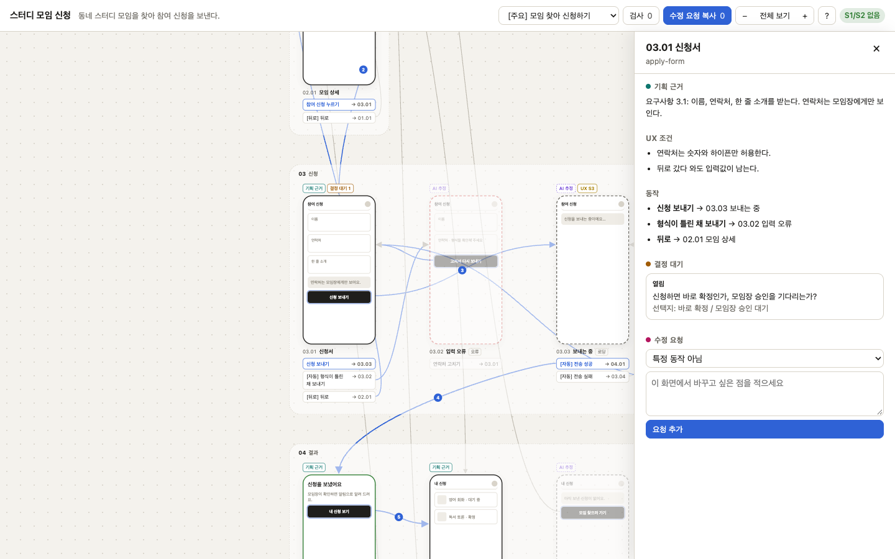

# lofo-dev-harness

**Claude Code를 오케스트레이터로**, **Codex를 구현·리뷰 워커로** 두고 소프트웨어를 만들 때 쓰는 공용 개발 하네스입니다.

실제로 운영한 사이드 프로젝트 세 개의 하네스를 합쳤습니다. 프로젝트마다 복사하던 규칙·훅·스킬·스크립트가 서로 갈라지는 문제를 없애는 것이 가장 큰 목표입니다.

> **상태: v0.3.** 협업 모드 프로젝트에서 쓸 수 있고, 와이어플로우로 화면을 설계하고 UX를 검토하는 기능도 들어 있습니다. Next.js·Supabase·Vercel은 전용 프리셋이 있고, 다른 스택은 일반 규칙이 들어갑니다. 자율 모드, QA 모듈, 추가 프리셋이 다음 순서입니다. 설계는 [`docs/design.ko.md`](docs/design.ko.md)에 있습니다. [English README](README.md)

## 설치

Claude Code 2.1.275 이상:

```
/plugin install lofo-dev-harness --marketplace jylee9937/lofo-dev-harness
```

이전 버전:

```
/plugin marketplace add jylee9937/lofo-dev-harness
/plugin install lofo-dev-harness@lofo-dev-harness
```

**필요한 것:**
- Claude Code, git, Python 3.8 이상 (표준 라이브러리만 씁니다)
- 선택:
  - [Codex CLI](https://github.com/openai/codex) 또는 Claude Code용 Codex 플러그인
  - PR을 만들 때 GitHub CLI(`gh`)

## 사용법

| 명령 | 하는 일 |
|---|---|
| `/lofo-dev-harness:init` | 문서 언어, 운영 모드, 프레임워크, DB, 배포 방식, 통과 검사 명령, 함께 쓸 도구, Codex 모델을 하나씩 묻습니다. 그 답으로 `.harness/config.json`을 쓰고 하네스 파일을 만듭니다. 설정을 직접 고친 뒤에는 `--refresh`로 다시 실행합니다. |
| `/lofo-dev-harness:start-task <작업 설명>` | 커밋하지 않은 변경을 확인하고, 기본 브랜치를 최신으로 받고, 브랜치 이름을 제안해 만듭니다. 그다음 하네스를 불러오고 작업이 어느 단계에서 시작하는지 알려 줍니다. |
| `/lofo-dev-harness:codex-delegate <작업>` | 구현·리뷰·진단을 설정의 모델과 effort로 Codex에 맡깁니다. 결과를 받으면 실제 결과를 찾아 diff를 확인하고 검사를 돌립니다. |
| `/lofo-dev-harness:wireflow [흐름]` | 요구사항을 와이어플로우로 옮기고 구조 문제를 검사합니다. 그다음 UX를 검토하고, 검토 보드를 만들고, 같은 화면과 검토 표시를 Figma·Pencil·기타 디자인 도구에 그립니다. |

`PreToolUse` 훅은 Claude가 소스 파일을 직접 고치기 직전에 "Codex에 먼저 맡기라"고 알려 줍니다. 백엔드 민감 경로에서는 더 강하게 알려 줍니다. 훅은 작업을 막지 않습니다. `.harness/config.json`이 없거나 Codex를 쓰지 않는 프로젝트에서는 아무것도 하지 않습니다.

### 화면 설계와 UX 검토 (`wireflow`)

[](docs/images/wireflow-board.png)

- **사용자 목표 하나에 파일 하나**: `design/flows/<id>.flow.json`. 담는 것:
  - 화면과 그 변형(빈 상태, 로딩, 오류, 완료)
  - 동작과 시나리오
  - 화면별 검토 표시: 기획 근거, UX 조건, 결정 대기, UX 이슈(S1~S4), 수정 요청
  기획서에 없는 화면은 *AI 추정*으로 표시됩니다. 스키마: [`schemas/flow.schema.json`](schemas/flow.schema.json). 예시: [`examples/flows/study-group.flow.json`](examples/flows/study-group.flow.json).
- **`python3 scripts/flow.py check`**가 잡는 것:
  - 끊긴 링크와 아직 없는 도착 화면
  - 도달할 수 없는 화면과 막다른 화면
  - 끝까지 갈 수 없는 구간
  - 복구 동작이 없는 오류 화면, 빠진 빈 상태·입력 오류 화면
  - 화살표와 맞지 않는 시나리오
- **`python3 scripts/flow.py build`**는 네트워크나 다른 의존성 없이 혼자 열리는 HTML 보드 한 파일을 만듭니다. 보드에서 할 수 있는 것:
  - 경로를 골라 번호 붙은 화살표로 강조
  - 화면을 눌러 검토 표시 보기
  - 와이어프레임과 내보낸 시안 이미지를 바꿔 가며 보기
  - 화면마다 수정 요청을 적고, 한 번에 복사해 AI에게 넘기기
- **디자인 도구**: 같은 화면·번호·화살표·검토 표시를 Figma나 Pencil에 그립니다. 다른 도구는 화면 이미지를 내보내 보드에서 함께 봅니다.
- **통과 기준**: 검사에서 S1/S2가 없고, 결정이 모두 정리됐고, 사용자가 보드를 검토하면 화면 설계 단계를 통과합니다.

### init이 만드는 파일

| 파일 | 내용 |
|---|---|
| `.harness/config.json` | 모델명, 통과 검사 명령, QA 포트, 라우팅 패턴을 모은 단일 설정. 커밋합니다. |
| `AGENTS.md` | `<!-- lofo-dev-harness:start -->`와 `<!-- lofo-dev-harness:end -->` 사이의 하네스 블록. Claude와 Codex가 같이 읽습니다. |
| `CLAUDE.md` | `@AGENTS.md` 가져오기 |
| `docs/dev-harness.md` | 역할, 프로세스, 스택별 규칙, 백엔드 협업, 검사, 기록 규칙 (관리 블록) |
| `.gitignore` | 내 컴퓨터에만 해당하는 값을 담는 `.harness/config.local.json`, `.harness/local/` |

다시 렌더링해도 마커 안쪽만 바뀝니다. 마커 바깥에 직접 쓴 내용은 그대로 남습니다.

## 설정

- 스키마: [`schemas/harness-config.schema.json`](schemas/harness-config.schema.json)
- 예시: [협업 모드, Next.js + Supabase + Vercel](examples/nextjs-supabase-vercel.config.json), [자율 모드](examples/autonomous.config.json)

로컬 경로처럼 내 컴퓨터에만 해당하는 값은 `config.json`에 넣지 않습니다. git에서 제외되는 `.harness/config.local.json`에 둡니다.

## 개발

```bash
python3 -m unittest discover -s tests       # 렌더러·훅·와이어플로우 테스트
claude plugin validate . --strict           # 플러그인·마켓플레이스 매니페스트 검사
claude --plugin-dir .                       # 로컬 체크아웃으로 플러그인 써 보기
```

## 참고

와이어플로우 검토 아이디어는 [wireflow-review](https://github.com/JeongK7998/wireflow-review)에서 영감을 받았습니다. 여기의 모델, 검사기, 보드는 코드를 가져오지 않고 새로 만든 것입니다.

## 라이선스

[MIT](LICENSE)
