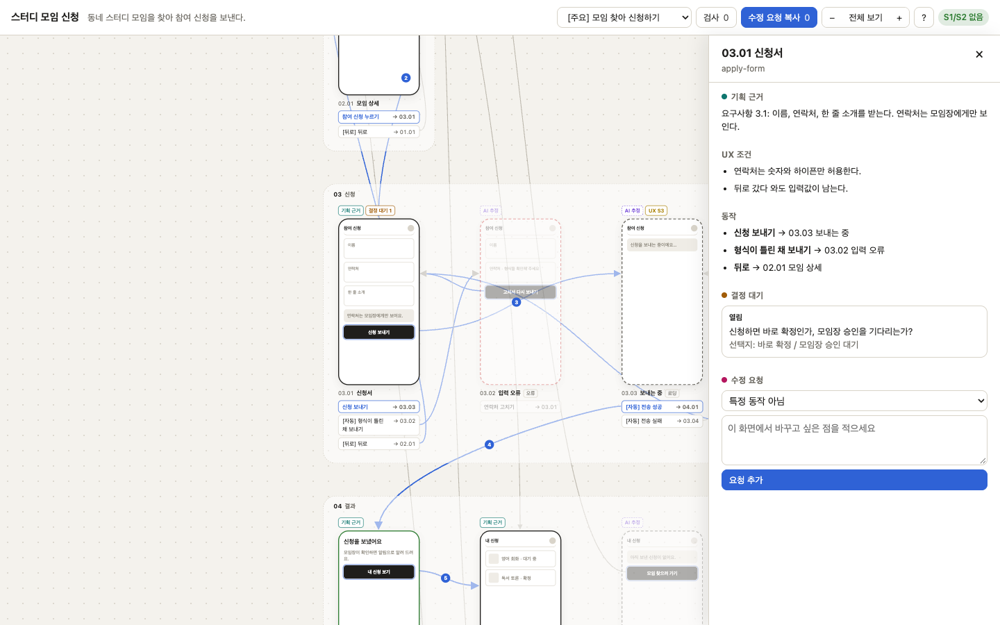

# lofo-dev-harness

A reusable development harness for building software with **Claude Code as the orchestrator** and **Codex as the implementation and review worker**.

It is distilled from the harnesses of three production side projects. The main goal is to stop copied rules, hooks, skills and scripts from drifting apart across projects.

> **Status: v0.4.** Usable for collaborative-mode projects. It includes wireflow-based screen design and UX review, and a security gate. Next.js, Supabase and Vercel have full presets. Other stacks get generic rules. Autonomous mode, the QA module and more presets are next; see [`docs/design.ko.md`](docs/design.ko.md) (Korean). [한국어 README](README.ko.md)

## Install

In Claude Code 2.1.275 or later:

```
/plugin install lofo-dev-harness --marketplace jylee9937/lofo-dev-harness
```

Older versions:

```
/plugin marketplace add jylee9937/lofo-dev-harness
/plugin install lofo-dev-harness@lofo-dev-harness
```

**Requirements:**
- Claude Code, git and Python 3.8 or later (standard library only)
- Optional:
  - the [Codex CLI](https://github.com/openai/codex) or the Codex plugin for Claude Code
  - the GitHub CLI (`gh`) for PRs

## Use

| Command | What it does |
|---|---|
| `/lofo-dev-harness:init` | Asks one question at a time: doc language, mode, framework, database, hosting, gate commands, integrations and Codex model. Writes `.harness/config.json`, then generates the harness files. Run it again with `--refresh` after editing the config. |
| `/lofo-dev-harness:start-task <task>` | Checks for uncommitted work, updates the default branch, proposes and creates a branch, loads the harness, and tells you which process stage the task starts at. |
| `/lofo-dev-harness:codex-delegate <task>` | Sends implementation, review or diagnosis to Codex with the configured model and effort. Then it collects the real result, checks the diff and runs the gates. |
| `/lofo-dev-harness:security-gate [--launch]` | For changes to auth, permissions, money, secrets, personal data, uploads, webhooks or permission migrations. Runs automated checks and the checklist, gets an independent read-only review (Codex first) ending in GO or NO-GO, and records it. Nothing merges before GO. |
| `/lofo-dev-harness:wireflow [flow]` | Turns requirements into a wireflow and checks it for structural problems. It then runs a UX review, renders a review board, and mirrors the screens and review marks into Figma, Pencil or any other design tool. |

A `PreToolUse` hook gives Claude two reminders before it edits a file. Neither one ever blocks, and the hook stays silent in projects without `.harness/config.json`.
- **Codex first**, for source files when Codex is enabled. The reminder is stronger for backend-sensitive paths.
- **Security gate**, for security-sensitive paths, whether or not Codex is enabled.

### Security gate (`security-gate`)

- **`python3 scripts/security.py`** (stdlib only) has five commands:
  - `scope` decides whether a change is in scope.
  - `scan` flags likely problems in changed files, or in everything with `--all`:
    - secrets and `.env` files in git, including a Supabase `service_role` key (anon keys are ignored)
    - SQL and Supabase filter injection
    - server entry points with no visible auth check or input validation
    - uploads without size or type limits, and login without attempt limits
    - fast hashes on passwords, unsigned webhooks
    - tables without RLS, `security definer` without `search_path`, and grants to `anon`
    Secret values are redacted in every output.
  - `audit` runs the npm or pnpm dependency audit against a threshold.
  - `prompt` writes the review brief.
  - `verdict` reads the reviewer's GO or NO-GO.
- **Checklist**: [`skills/security-gate/references/checklist.md`](skills/security-gate/references/checklist.md) always starts with five essentials:
  1. server-side input validation against SQL injection
  2. login attempt limits against brute force
  3. password hashing
  4. upload type and size limits
  5. dependency audit
- **When Codex cannot review** (default `security.substitute: hold`), a Claude reviewer looks first. Its GO is only provisional, and merge waits for a Codex GO or the user's explicit approval of that change.
- **Accepted false positives** are silenced in place with `// security-ok: <rule> <reason>`.

### Screen design and UX review (`wireflow`)

[](docs/images/wireflow-board.png)

- **One source file per user goal**: `design/flows/<id>.flow.json`. It holds:
  - screens and their variants (empty, loading, error, success)
  - actions and scenarios
  - per-screen review marks: planning rationale, UX conditions, open decisions, UX issues (S1–S4) and change requests
  Screens the requirements do not ask for are marked *AI inferred*. Schema: [`schemas/flow.schema.json`](schemas/flow.schema.json). Example: [`examples/flows/study-group.flow.json`](examples/flows/study-group.flow.json).
- **`python3 scripts/flow.py check`** catches:
  - broken links and destinations not designed yet
  - unreachable screens and dead ends
  - loops with no way to finish
  - error screens without recovery, and missing empty or validation-error states
  - scenarios that do not match the arrows
- **`python3 scripts/flow.py build`** writes a single self-contained HTML board with no network or dependencies. On the board you can:
  - highlight a journey with numbered arrows
  - open a screen's marks
  - switch between wireframes and exported design images
  - write change requests per screen and copy them as one block for the AI
- **Design tools**: the same screens, numbers, arrows and marks are drawn in Figma or Pencil. For any other tool, exported screen images appear on the board.
- **Stage gate**: screen design passes when checks show no S1/S2, every decision is settled, and the user has reviewed the board.

### What `init` generates

| File | Content |
|---|---|
| `.harness/config.json` | Single source for model names, gate commands, QA port and routing patterns. Commit it. |
| `AGENTS.md` | Harness block between `<!-- lofo-dev-harness:start -->` and `<!-- lofo-dev-harness:end -->`. Claude and Codex both read it. |
| `CLAUDE.md` | `@AGENTS.md` import. |
| `docs/dev-harness.md` | Roles, process, stack rules, backend collaboration, gates and records, as a managed block. |
| `.gitignore` | `.harness/config.local.json` and `.harness/local/` for machine-specific values. |

Re-rendering only rewrites text between the markers. Your own notes outside them are kept.

## Configuration

- Schema: [`schemas/harness-config.schema.json`](schemas/harness-config.schema.json)
- Examples: [collaborative, Next.js + Supabase + Vercel](examples/nextjs-supabase-vercel.config.json) and [autonomous](examples/autonomous.config.json)

Machine-specific values such as local paths never go in `config.json`. They belong in `.harness/config.local.json`, which is gitignored.

## Development

```bash
python3 -m unittest discover -s tests       # renderer, hook and wireflow tests
claude plugin validate . --strict           # plugin and marketplace manifests
claude --plugin-dir .                       # try the plugin from a local checkout
```

## Acknowledgements

The wireflow review idea was inspired by [wireflow-review](https://github.com/JeongK7998/wireflow-review). The model, checker and board here are an independent implementation; no code was copied.

## License

[MIT](LICENSE)
